 

Second-year **B.E. CSE** (Chennai) who ships AI that reaches real users. I measure design
decisions against benchmarks and held-out sets, and I care about systems that stay
**reviewable and reversible**. Long game: founding my own company.

### Selected work

| Project | What it is | Stack |
|---|---|---|
| [**RAWRS**](https://github.com/winvinayainfosystemsindia/RAWRS---V1) | PDFs → accessible DOCX for blind readers; ~3h → 10–20 min | Qwen2.5-VL · FastAPI · Surya OCR · React |
| [**Thadam**](https://github.com/SomeNobody21112/Thadam) | Audit-lead risk scoring over 476,781 lifecycle events | Sentence Transformers · lifelines · scikit-learn |
| [**ICHNOVA**](https://github.com/SomeNobody21112/ICHNOVA) | Blind radio-signal decoder, 30/30 held-out, 0 false accepts | NumPy · SciPy · Viterbi · React 19 |
| [**llama.cpp** #30630](https://github.com/ggml-org/llama.cpp/pull/30630) | NumPy Q1_0/Q2_0 GGUF quantization — merged | Python · gguf-py · C reference parity |

### Toolkit

<!-- animated contribution snake (generated by the workflow, see .github/workflows/snake.yml) -->
<picture>
  <source media="(prefers-color-scheme: dark)" srcset="https://raw.githubusercontent.com/SomeNobody21112/SomeNobody21112/output/snake-dark.svg" />
  
</picture>

  

 

**[somenobody21112.github.io](https://somenobody21112.github.io)** &nbsp;·&nbsp; **[LinkedIn](https://linkedin.com/in/sri-ramaanuja-dasan)**

